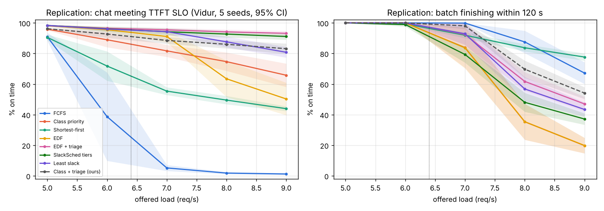
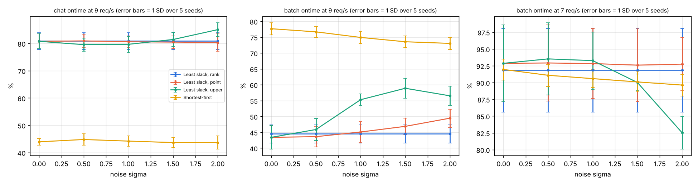
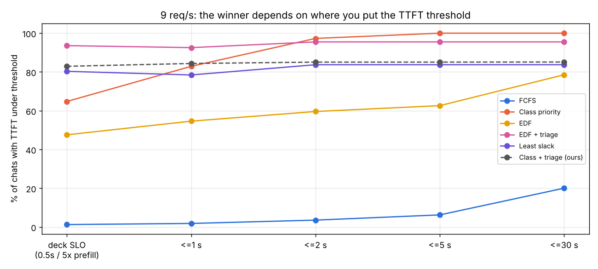
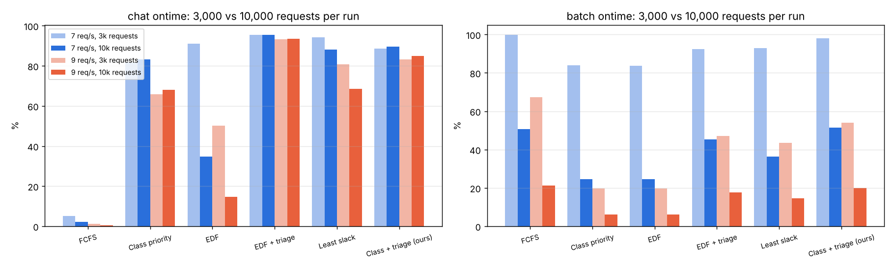

# SlackSched midterm: hostile review and independent replication

Reviewer stance: assume every claim is wrong until checked. Deck checked: "COMS 6998 Midterm Presentation.pdf" (28 slides, read in full, including every chart image). Your code wasn't available, so I rebuilt the experiments on microsoft/vidur (commit `abae7f6`, Aug 2026) using its bundled A100 / Llama-3-8B profiles and the bundled Azure trace. I ran 817 simulations in total.

**Bottom line.** The numbers reproduce. Most of my scorecard values land within 1–4 points of yours, so you didn't make an arithmetic or plumbing mistake. The interpretation is where the deck is weak:

1. Every headline result comes from a transient overload experiment whose outcome depends on run length.
2. Two of the three takeaways are either true by construction or don't survive simple controls.
3. Two of the novelty claims are already covered by published work.

---

## 1. Verdict table

| # | Claim (slide) | Verdict | Evidence |
|---|---|---|---|
| 1 | Setup reproduces: Vidur, Llama-3-8B, A100, Azure sizes, Poisson, 3,000 requests | **Confirmed** | Scorecard reproduces (see §3.1). The median decode length of 129 tokens matches Vidur's `splitwise_conv.csv`, which is the **Azure 2023 *conversation* trace** (the deck never says which trace). |
| 2 | "Capacity ≈ 6" | **Partially true, and mislabeled** | Measured service rate under overload is **6.34 req/s**. Vidur's Poisson generator **clips gaps at 3/qps**, so the real offered rate is qps/(1−e⁻³) ≈ **1.05× nominal**. Nominal 6 is really 6.45 (≈102% of capacity), 7 is 7.5 (118%), and 9 is 9.5 (150%). Only 5 req/s is under capacity. |
| 3 | At 7 req/s FCFS gets 5% of chats on time vs 96% for deadline-aware | **Confirmed (numbers), misleading framing** | Mine: FCFS 5%; EDF+triage 95%, least slack 94%, tiers 94%, EDF 91%. But 7 req/s is 118% of capacity, not "near capacity" (the label on slide 11). |
| 4 | At 9 req/s: EDF 54%, EDF+triage 94% | **Confirmed** | Mine: EDF 50 ± 11% (95% CI, 5 seeds), EDF+triage 93 ± 2%. |
| 5 | Scorecard at 9 req/s (7 rows) | **Confirmed numerically** | See §3.1. The only notable gap is SlackSched tiers, where I get 37% batch vs your 25%; my "starving batch" threshold (30 s) is a guess. |
| 6 | Goodput column | **Reconciles, but wrongly attributed and inflated** | Goodput = (chat + batch on-time count) / arrival span. 9.47 × (on-time% averaged over the two classes) matches every row to ±0.05. That 9.47 is the clipped-Poisson rate, not 9. And it is **not DistServe's definition**: DistServe defines goodput as the max request rate sustainable at a target attainment (e.g. 90%), per GPU. The slide cites DistServe for a different metric. |
| 7 | "Deadline-aware ordering rescues chat" / "5% → 96%" | **Partially true, overstated** | True only for the TTFT target. Under your own definitions (TTFT **and** 50 ms TPOT), chat attainment at ≥7 req/s is **< 1% for every strategy** (§3.5). The takeaway also mixes the 7 req/s FCFS figure (5%) with the 9 req/s triage result. |
| 8 | Triage toy example (A/B/C) | **Confirmed** | Recomputed: EDF gives 0/3 on time, triage gives 2/3. This is the textbook EDF domino effect from 1980s–90s real-time scheduling (Locke; Buttazzo; D-over), which the deck doesn't cite. |
| 9 | "Triaged chats wait ~5 min (slowest 1%)" | **Run-length artifact** | p99 is 336 s at 3k requests but **946–983 s at 10k requests**. In real overload, this wait grows without bound. |
| 10 | "The simplest strategy is still the best one" | **Refuted / unsupported** | EDF+triage is not the simplest strategy. A trivial *class priority + triage* baseline (mine) gets 83% chat / 54% batch / 6.6 goodput vs EDF+triage's 93% / 47% / 6.8. *Shortest-prompt-first* (one line of code) gets the **highest goodput of anything at 9 req/s (7.2)**. With a TTFT threshold of ≤ 2 s instead of 0.5 s, plain class priority beats EDF+triage (97% vs 95%). |
| 11 | RQ2: chat 81–87% regardless of σ | **Confirmed, but tautological** | Mine: 80–85%. Chat slack = deadline − now − *prefill time*. The length prediction **never enters a chat request's key**, as your own backup slide says. "Prediction doesn't matter for chat" is true by construction, not a finding. |
| 12 | Shortest-first ~46% regardless of σ | **Confirmed, wrong explanation** | Mine: 44%. SJF sorts on *decode* length, but TTFT depends on *prompt* length. Sorting by prompt length gets 63% chat (91% for short-prompt chats). |
| 13 | "All three modes put requests in the same order" (slide 20) | **False** | For least slack, a batch request's slack includes est × 15 ms, so the mode changes the order. In **ranking-only mode, est is a constant 129**, so prediction enters the key **nowhere**. The "ranking only" line is flat because it uses zero prediction information (my runs are bit-identical across σ), not because ranking is robust. |
| 14 | RQ2: at 9 req/s, upper bound gives 43% → 60% batch; slowest 359 → 454 s | **Confirmed numerically, misattributed** | Mine: 43 → 59% (σ = 1.5), slowest 365 → 422 s. A pure-pessimism control with **perfect** predictions × 8 gets **84% batch** (and goodput 7.8). The gain comes from pessimism (giving up on batch sooner), not from upper-bound information. |
| 15 | RQ2: at 7 req/s, the "same pessimism hurts": 97% → 86% | **Confirmed numerically, misattributed** | Mine: 93 → 83%. But perfect predictions × 13 (the same inflation as e^(1.28·2)) still get **97%** at 7 req/s. What hurts is *noise* combined with inflation, not pessimism. "Ranking vs bound depends on load" is really "noise hurts at 7, pessimism helps at 9". |
| 16 | Kendall τ table {1, .65, .47, .35, .27} | **Slightly off** | Empirical on the conv trace (3,000 requests, 5 reps): {1, .648, .435, .322, .253}. Analytic for lognormal: (2/π)·asin(s_L/√(s_L²+σ²)) with s_L = 0.86 gives {.66, .45, .33, .26}. Your values at σ ≥ 1 run high by about 0.02–0.035, well beyond sampling noise (SD ≈ 0.01). Say how you computed τ. |
| 17 | 129 tokens ≈ 1.9 s; upper bound 200 × e^1.28 = 720 ≈ 10.8 s | **Confirmed** | 200 × e^1.28 = 719.3. The "right ~90% of the time" claim holds only because the noise is exactly lognormal with a known σ (z > −1.28). That is oracle calibration a real predictor doesn't have. Also, 129 is the *median*; the mean is 211, so "typical" underestimates batch time. |
| 18 | Side finding: at 6 req/s only 19% of chats meet 50 ms TPOT while 65% meet TTFT | **Not robust; artifact of the v0 scheduler** | Mine (5 seeds): TPOT 10% (range 2–20%), FCFS TTFT 39% (**range 9–64% across seeds**). Under Vidur's Sarathi (chunked-prefill, V1-like) scheduler, FCFS at 6 req/s meets TPOT for **83%** of chats (range 73–95% over 5 seeds) and TTFT for 63%. "Reordering can't fix speed, that's why DistServe splits phases" skips the obvious fix: chunked prefill (Sarathi-Serve, vLLM V1's default). |
| 19 | Batch deadline 120 s "shortened so it fits our simulated time" | **Justification is false; choice drives the batch results** | Runs last about 470 s and Vidur runs until the queue drains, so 300 s fits fine. At 300 s, **every deadline-aware strategy gets 100% batch at 9 req/s**, and the "chat-first: batch falls to 22–48%" tradeoff disappears. |
| 20 | "Explicitly giving up on hopeless requests" is open (related work) | **Refuted** | Scorpio (arXiv 2505.23022, 2025): least-deadline-first ordering plus rejecting requests predicted to miss their TTFT target. Mooncake: prediction-based early rejection under overload. JITServe (the NSDI '26 paper you cite): admission control drops requests that wait past a max time. |
| 21 | "Ranking vs upper bound never compared head to head" | **Partially refuted** | JITServe (NSDI '26) runs Learn-to-Rank (Fu et al.) as an **end-to-end baseline** under the same SLO-goodput metric and beats it. What hasn't been done is an isolated ablation that holds the scheduler fixed and swaps only the predictor type. That narrower claim is defensible, but your experiment doesn't do it either (item 13). |
| 22 | NSDI '26 Zhang et al.: 1.4–6.3× goodput, within 3–9% of oracle, upper-bound estimates refined during decoding | **Confirmed** | JITServe (Wei Zhang, …, Fan Lai, UIUC). Uses a quantile regression forest upper bound, re-estimated about every 50 tokens, with cost-aware preemption. Name the system. |
| 23 | Vidur "under 9% error" | **Confirmed, but it doesn't cover your regime** | The claim is request-level latency error with the vLLM scheduler, measured at ≤ 85% of capacity. The paper itself says error "blows up" near capacity (12.65% at 95%). **All of your headline numbers come from 102–150% of capacity.** Also, in my training run the `attn_kv_cache_save` model reported 101% MAPE. It's a small op, but worth knowing. |
| 24 | "~250 runs: 105 load + 140 noise" | **Partially inconsistent** | 105 = 7 strategies × 5 loads × 3 seeds checks out. 140 doesn't factor cleanly into 4 lines × 5 σ × 2 loads × seeds (it would need 3.5 seeds). The scorecard caption says "3 runs" while the setup says "2–3". Clarify. |
| 25 | QLM, SLOs-Serve, S³, Fu et al., TRAIL, InferCept, Autellix, Continuum, DistServe | **Exist; mostly fair** | QLM targets *exactly your setting* (interactive + batch SLOs, one queue, eviction), so say so. TRAIL is "Don't Stop Me Now: Embedding Based Scheduling for LLMs" (ICLR '25). InferCept is about KV handling during tool-call pauses, not deadline-driven kick-outs. SLOs-Serve is DP token allocation over chunked prefill, not EDF. |

---

## 2. Biggest problems, ranked by severity

### P1 (fatal for the headline framing). Every overload result is a transient that depends on run length.
At 9 req/s, arrivals stop around 316 s and the server then drains a backlog for about 160 s more. The queue never reaches a steady state, because there is no steady state above capacity. I reran with 10,000 requests per run:

| 9 req/s | chat on time (3k → 10k) | batch on time (3k → 10k) | goodput (3k → 10k) | p99 chat TTFT (3k → 10k) |
|---|---|---|---|---|
| FCFS | 1% → 0% | 67% → 21% | 3.3 → 1.0 | 151 s → 490 s |
| EDF | 50% → **15%** | 20% → 6% | 3.4 → 1.0 | 61 s → 405 s |
| EDF + triage | 93% → 94% | 47% → **18%** | 6.8 → 5.3 | 336 s → **983 s** |
| Least slack | 81% → 68% | 43% → 15% | 6.0 → 3.9 | 354 s → 1018 s |
| Class priority | 66% → 68% | 20% → 6% | 4.1 → 3.5 | 2 s → 2 s |

At 7 req/s the 10k runs give EDF chat 91% → **35%** and EDF+triage batch 92% → **45%**. So "chat stays at 94% under heavy overload" holds only because triage turns the queue into "serve fresh arrivals, abandon the backlog". The abandoned backlog grows without limit. Every batch number, every goodput number and every "slowest wait" number is a function of how long you ran. Any reviewer will catch this. Fix: run at ≤ 95% of capacity with a warm-up window cut off, or keep overload but report results as a function of time or backlog and say explicitly that it's transient.

### P2. RQ2's design can't answer RQ2.
* In ranking-only mode, least slack uses **no prediction at all** (est = 129 for everyone). That's not "a ranking predictor", it's "no predictor". A ranking scheduler would actually use the order: shortest-first, the tiers' batch tier, or a rank-to-quantile mapping.
* For chat, prediction never enters the key, so "barely matters for chat" is tautological.
* The upper-bound mode's batch gain is reproduced by inflating *perfect* predictions (true × 8 → 84% batch at 9 req/s vs 56–59% for the upper bound). The mechanism is *pessimism → earlier triage of batch*, not bound-vs-rank. At 7 req/s, true × 13 gives 97% batch, so pessimism alone doesn't hurt there; noise does.
* The upper bound is computed with the *true* σ (oracle calibration). Real predictors (S³'s buckets, Fu's ranker, JITServe's QRF) have length-dependent error and regress toward the mean. Multiplicative i.i.d. lognormal noise is a best case for ordering.

### P3. The metric decides the winner.
* At 9 req/s, if the chat target is TTFT ≤ 2 s instead of 0.5 s / 5× prefill, **class priority (97%) beats EDF+triage (95%)**, and class priority's p99 is 2 s vs 336 s. See `figs/rep_ttft_threshold.png`.
* 42% of chats have a relaxed target (> 0.5 s) because 5× prefill exceeds 0.5 s for prompts above roughly 1,000 tokens. That's defensible, but the "0.5 s" headline hides it.
* Under the full chat SLO (TTFT + TPOT), everyone gets < 1% at ≥ 7 req/s.
* Goodput counts a chat answered at 400 s as a "miss" but still spends GPU time on it. Triage's real advantage is *wasting less compute on lost causes*. Actually dropping them, as Scorpio and Mooncake do, is the fair comparison and would raise goodput further.
* Shortest-prompt-first gets the highest goodput at 9 req/s (7.2 vs 6.8), so "best overall row" by goodput isn't even EDF+triage. It starves long-prompt chats (28% on time), which is exactly why one scalar goodput number isn't a sufficient scorecard.

### P4. Baselines are weak, and the novelty claims overlap prior work.
* FCFS at 150% load is a strawman.
* vLLM ships `--scheduling-policy priority` ("lower value means earlier handling, time of arrival deciding ties", from vLLM's `config/scheduler.py`). So "class priority" *is* vLLM's built-in alternative, and the slide-2 claim "vLLM serves first come first served" is only true of the default.
* Missing baselines: class + triage, shortest-prompt-first, and actual rejection or admission control.
* Missing related work (verified via search): **Scorpio** (2025: least-deadline-first + rejection, the closest prior work), **Mooncake** early rejection, **HyGen** (NeurIPS '25, online/offline co-location), **ConServe** (ICML '26, online/offline co-serving), **Andes** (TTFT/TPOT QoE).
* Also missing, from my own knowledge (not re-verified): Sarathi-Serve (OSDI '24), Llumnix (OSDI '24, priorities/migration), VTC fairness (OSDI '24), and classical real-time overload scheduling.

### P5. The simulator regime is outside Vidur's claimed fidelity, and the v0 scheduler drives your side finding.
Vidur's < 9% error is validated at ≤ 85% of capacity, and the paper reports degradation near capacity. Your interesting regime is 118–150%.

Vidur's vLLM v0 scheduler stalls all decodes whenever a prefill can be admitted. That's why TPOT fails (slide 22), and it disappears with Sarathi/chunked prefill (83% TPOT-ok at 6 req/s, 5 seeds). vLLM V1, which you mention, uses chunked prefill by default. The answer on slide 28 ("we can rerun on Sarathi") should be done before the final, not deferred.

### P6. Statistical thinness near the knee.
At 6 req/s, FCFS chat-on-time ranges from **9% to 64% across seeds** (5 seeds). EDF at 9 req/s has ±11% CI half-width. With 2–3 seeds, the FCFS curve on slides 8 and 22 (including the "65%" quoted on slide 22) is not trustworthy. Show CIs and use ≥ 5 seeds. Seeds are cheap: about 8 s per run.

### P7. Memory pressure doesn't exist in the current configuration.
Vidur sizes the KV cache at 118 slots × 4,096 tokens ≈ 483k tokens (30k blocks). With batch_size_cap = 128 and roughly 1,400 tokens per request, KV never binds: **0 preemptions in all 175 main runs**. So slide 3's "who gets kicked out if memory runs out" is never exercised.

When I force it, by setting `num_blocks` to 8,192 (≈ 131k tokens) and then 2,048 (≈ 33k tokens, about 130 recompute-preemptions per run), the effective capacity drops below 5 req/s. EDF+triage still wins on chat (80–86%), class priority and EDF collapse (2% chat at 9 req/s), and shortest-first triggers the most preemptions. The qualitative ranking of EDF+triage survives; the magnitudes don't.

### P8. Smaller issues.
* "Near capacity (7 req/s)" is really 118% of capacity.
* Kendall τ is about 0.02–0.035 high at σ ≥ 1.
* The y-axis is truncated on slide 10.
* The scorecard caption contradicts "2–3 repeats".
* The 120 s deadline justification is wrong.
* Vidur skips CPU scheduling overhead by default (`skip_cpu_overhead_modeling=True`), so sorting a queue of thousands every iteration is free in the simulator.

---

## 3. Replication results

**Implementation.** `slacksim_replica.py` wraps `VLLMReplicaScheduler._get_next_batch` and sorts `_request_queue` by a strategy key before every scheduling step. Batching, memory and preemption are Vidur's own (restarted requests keep vLLM's "go first" behaviour).

**Workload.** Request sizes are sampled i.i.d. from `splitwise_conv.csv`, clipped at 4,096 tokens the way Vidur clips them. Class is chat/batch at 50/50 i.i.d. Arrivals use Vidur's clipped Poisson.

**Deadlines and slack.** Chat deadline = arrival + max(0.5, 5 × no-load prefill), with prefill time taken from Vidur's own trained predictor. Batch deadline = arrival + 120 s. Batch remaining time = prefill + est × 15 ms.

**Other choices.** Triage = negative slack goes to the back. TPOT = (completion − first token) / (decode − 1). Least slack sends negative-slack requests to the back. My SlackSched tiers interpretation is: chat by slack, then batch with slack < 30 s, then the rest shortest-first, with hopeless requests last.

**Run counts.** Seeds: 5 for the main and σ grids, 3 for the stress and inflate grids, 2 for the 10k runs. Each run took about 5–15 s of wall time. Training Vidur's predictors took about 22 min once.

### 3.1 Scorecard at 9 req/s (theirs vs mine; mine is a 5-seed mean ± 95% CI)

| Strategy | Chat on time | Batch on time | Goodput | p99 chat TTFT | Slowest batch |
|---|---|---|---|---|---|
| FCFS | 2% / **1 ± 1%** | 73% / **67 ± 7%** | 3.5 / **3.3** | 138 / **151 s** | 179 / **196 s** |
| Class priority | 70% / **66 ± 8%** | 22% / **20 ± 5%** | 4.4 / **4.1** | 1.7 / **2 s** | 266 / **280 s** |
| Shortest-first | 46% / **44 ± 2%** | 79% / **78 ± 2%** | 5.9 / **5.9** | 380 / **390 s** | 453 / **454 s** |
| EDF | 54% / **50 ± 11%** | 22% / **20 ± 5%** | 3.6 / **3.4** | 56 / **61 s** | 241 / **260 s** |
| EDF + triage | 94% / **93 ± 2%** | 48% / **47 ± 5%** | 6.7 / **6.8** | 310 / **336 s** | 354 / **367 s** |
| SlackSched tiers | 92% / **91 ± 2%** | 25% / **37 ± 4%** | 5.6 / **6.2** | 368 / **343 s** | 247 / **379 s** |
| Least slack | 82% / **81 ± 3%** | 44% / **43 ± 5%** | 6.0 / **6.0** | 363 / **354 s** | 361 / **365 s** |
| *Class + triage (new)* | **83 ± 3%** | **54 ± 4%** | **6.6** | **369 s** | **350 s** |
| *Shortest-prompt-first (new)* | **63%** | **87%** | **7.2** | **372 s** | **457 s** |

### 3.2 Chat on time vs nominal load (mine, 5 seeds)

| Strategy | 5 | 6 | 7 | 8 | 9 |
|---|---|---|---|---|---|
| FCFS | 91% | 39% | 5% | 2% | 1% |
| Class priority | 96% | 89% | 82% | 75% | 66% |
| Shortest-first | 91% | 72% | 55% | 50% | 44% |
| EDF | 98% | 96% | 91% | 63% | 50% |
| EDF + triage | 98% | 97% | 95% | 94% | 93% |
| SlackSched tiers | 98% | 96% | 94% | 93% | 91% |
| Least slack | 98% | 96% | 94% | 88% | 81% |

### 3.3 Prediction-noise sweep (mine, 5 seeds, mean ± SD)

| load | mode | metric | σ = 0 | 0.5 | 1 | 1.5 | 2 |
|---|---|---|---|---|---|---|---|
| 9 | least slack, ranking | chat / batch | 81 / 44 | 81 / 44 | 81 / 44 | 81 / 44 | 81 / 44 (identical: uses no prediction) |
| 9 | least slack, point | chat / batch | 81 / 43 | 81 / 44 | 81 / 45 | 81 / 47 | 80 / 49 |
| 9 | least slack, upper | chat / batch | 81 / 43 | 80 / 46 | 80 / 55 | 81 / 59 | 85 / 56 |
| 9 | shortest-first | chat / batch | 44 / 78 | 45 / 77 | 44 / 75 | 44 / 74 | 44 / 73 |
| 7 | least slack, upper | batch / slowest | 93% / 153 s | 94% / 152 s | 93% / 434 s | 90% / 431 s | 83% / 430 s |
| 7 | least slack, point | batch / slowest | 93% / 153 s | 93% / 157 s | 93% / 184 s | 93% / 405 s | 93% / 433 s |

**Pessimism control** (σ = 0, est = true length × k, least slack, 5 seeds):

| load | k = 1 | 2 | 4 | 8 | 13 |
|---|---|---|---|---|---|
| 9 (chat / batch / goodput) | 81 / 43 / 6.0 | 80 / 45 / 6.0 | 79 / 51 / 6.3 | 77 / **84** / **7.8** | 75 / 81 / 7.5 |
| 7 (chat / batch) | 94 / 93 | 94 / 94 | 95 / 94 | 93 / **99** | 92 / **97** |

### 3.4 Stress tests (chat / batch on time; 3 seeds)

| Condition | load | FCFS | Class | SJF | EDF | EDF + triage | Least slack | Class + triage |
|---|---|---|---|---|---|---|---|---|
| Baseline (§3.2) | 9 | 1/67 | 66/20 | 44/78 | 50/20 | 93/47 | 81/43 | 83/54 |
| 80/20 chat mix | 9 | 1/65 | **2/2** | 44/76 | **4/2** | 82/42 | 68/43 | 66/52 |
| 80/20 chat mix | 7 | 4/100 | 34/27 | 55/91 | 23/27 | 89/92 | 85/93 | 77/100 |
| Batch deadline 300 s | 9 | 1/100 | 65/100 | 44/92 | 78/100 | 93/100 | 90/100 | – |
| True (unclipped) Poisson | 9 | 2/73 | 66/23 | 46/79 | 52/23 | 93/52 | 82/47 | – |
| Bursty (gamma CV = 2) | 9 | 1/80 | 45/24 | 34/81 | 36/24 | 86/65 | 77/62 | 70/82 |
| KV 8,192 blocks | 9 | 1/67 | 56/18 | 42/77 | 42/18 | 91/51 | 80/48 | 76/60 |
| KV 2,048 blocks (~130 preemptions/run) | 5 | 1/93 | 59/41 | 45/90 | 44/42 | 86/100 | 84/100 | – |
| KV 2,048 blocks | 9 | 1/30 | 2/1 | 34/66 | 2/1 | 80/40 | 59/25 | – |
| 10k requests | 9 | 0/21 | 68/6 | – | 15/6 | 94/18 | 68/15 | 85/20 |
| 10k requests | 7 | 2/51 | 83/25 | – | 35/25 | 95/45 | 88/36 | 90/51 |

**What survives:** EDF+triage has the best chat-TTFT attainment in every condition I tried (mix, burstiness, KV pressure, unclipped arrivals).

**What doesn't survive:** the batch numbers, goodput, tail waits, "class priority is reasonable" (it collapses at an 80/20 mix), the RQ2 interpretation, and "slowest 1% waits ~5 min".

### 3.5 TTFT vs full chat SLO (mine)

Share of chats meeting TTFT **and** TPOT ≤ 50 ms: about 69% at 5 req/s, about 9% at 6, and **≤ 0.5% at 7, 8 and 9 for every strategy**.

FCFS under Sarathi chunked prefill (no reordering): TPOT-ok 99% / 83% / 12% at 5 / 6 / 7 req/s (5 seeds, `results/sarathi.jsonl`), versus 72% / 10% / 2% under the vLLM v0 scheduler. *Correction: an earlier version of this review said 95% at 6 req/s, which was a single seed.*

 

---

## 4. Fixes

### Before Oct 29 (wording and labels only; no new science needed)
1. Add the capacity line (≈ 6.3 req/s measured) to every load plot. Relabel the axis as offered/capacity, or at least say "7 = 118%, 9 = 150% of capacity". Note Vidur's clipped Poisson (+5% rate).
2. Retitle Result 1 as "...rescues chat **time-to-first-token**". State that chat on time ignores TPOT and that under the full SLO everyone fails at ≥ 7.
3. Add one honest sentence: "Results above capacity are transient over a 3,000-request run; with 10k requests, batch and tail numbers degrade sharply." Better to say it before someone asks.
4. Delete "The simplest strategy is still the best one". Replace it with "EDF + triage had the best chat-TTFT attainment in all conditions we tried."
5. Fix slide 20: the modes do *not* produce the same order, and ranking-only least slack uses no prediction. Reframe RQ2 results as "pessimism vs noise", or present them as preliminary.
6. Change takeaway 2 to: "For chat TTFT, length prediction can't matter in our design, because chat urgency depends only on the prompt."
7. Related work:
   * Remove "explicitly giving up on hopeless requests" as a gap (Scorpio, Mooncake, JITServe).
   * Say JITServe already runs LTR as a baseline, and narrow the claim to "isolated, same-scheduler ablation".
   * Add Scorpio, Sarathi-Serve, and QLM-is-the-same-setting.
8. Name the trace (Azure LLM inference trace 2023, conversation). Name JITServe. Fix the DistServe goodput attribution, or rename your metric "on-time throughput".
9. Drop or soften Result 5 (TPOT), or add "artifact of vLLM v0 prefill-first scheduling; chunked prefill fixes it."
10. Show 95% CIs on slide 8. Fix the "3 runs" vs "2–3" inconsistency.

### Before Dec 10 (methodology)
1. **Steady state:**
   * Long runs (≥ 20k requests or a fixed duration) with warm-up and cool-down trimmed, at 70–100% of capacity.
   * For overload, an explicit admission/rejection policy so a steady state exists. Report how many requests were rejected.
   * Report attainment vs load curves and DistServe-style goodput (max rate at ≥ 90% attainment).
2. **Real triage:** compare "move to back" vs "reject" vs "route elsewhere". Count compute wasted on lost causes.
3. **Baselines:**
   * vLLM priority policy (= class priority)
   * class + triage
   * shortest-prompt-first
   * Scorpio-style least-deadline-first + rejection
   * an LTR scheduler that actually *uses* the ranking (e.g., map predicted rank to an empirical length quantile for the slack math)
4. **RQ2 redesign:**
   * Hold the scheduler fixed and vary only the estimator: point, calibrated quantile, rank → quantile.
   * Add a pessimism control (true × k).
   * Use realistic error models (regression to the mean, bucket classifiers, or an actual trained predictor on the conversation trace).
   * Calibrate the bound without access to σ.
5. **Scheduler:** rerun the headline grid on Vidur's Sarathi (chunked prefill) scheduler, which matches vLLM V1 better. Hook it the same way: it has the same `_request_queue`.
6. **SLO sensitivity:** sweep the TTFT target (0.5 / 1 / 2 s) and the batch deadline (120 / 300 / 600 s), and show where the ranking of strategies flips.
7. **Memory pressure:** use a constrained KV cache (`--vllm_scheduler_config_num_blocks`) or a bigger model / longer contexts to get real preemption before attempting RQ3. Report the preemption count.
8. **Realistic arrivals:** use the trace's own timestamps (time-scaled) instead of Poisson. This is real Azure burstiness.
9. **Real-GPU check:** run it in the *under-capacity* regime, where it can actually validate Vidur. Note that a T4 can't run Llama-3-8B in FP16 with meaningful KV room, so pick a smaller model and recalibrate.

---

## 5. Tough questions a professor will ask, with good answers

**Q: Your load goes to 1.5× capacity. Isn't the queue just growing without bound? What does "94% on time" even mean then?**
A: Yes. Above capacity there's no steady state. Triage keeps fresh chats on time by abandoning a growing backlog. With 10k requests, chat attainment holds but batch drops to about 18% and abandoned chats wait about 16 min. For the final, we'll add explicit rejection so overload has a steady state, and report attainment vs load at ≤ 100% capacity.

**Q: Your chat SLO is TTFT only. What about TPOT?**
A: Under the full SLO, nobody passes at ≥ 7 req/s. That's the v0 scheduler's prefill-first behaviour. With chunked prefill (Sarathi / vLLM V1), TPOT mostly recovers. We'll rerun on Sarathi.

**Q: Why does length prediction not matter for chat?**
A: In our formulation, chat urgency depends only on the prompt (prefill time), so it can't matter. It's a design consequence, not an empirical finding. The interesting question is batch-side and tail behaviour.

**Q: Isn't the upper-bound gain just being more pessimistic?**
A: Yes. Inflating *perfect* predictions by 8× gives more batch gain than the noisy upper bound. Next we'll separate calibration from pessimism.

**Q: Your "ranking only" mode: what ranking does it use?**
A: In least slack, none. It's effectively EDF for batch. We'll replace it with a mode that maps the predicted rank to a length quantile.

**Q: How is this different from Scorpio / JITServe / QLM?**
A: They're full systems, and Scorpio and JITServe already do deadline ordering plus rejection/dropping. Our contribution is a controlled ablation on a shared simulator: which ingredient (triage, prediction type, pessimism) buys what, as a function of load and SLO definition.

**Q: Why trust Vidur at 150% load?**
A: We shouldn't fully. Its validation stops at about 85% of capacity. Comparisons between policies share the same timing model, but queueing effects amplify small errors near capacity. The GPU check will be done under capacity.

**Q: Class priority has a 2 s p99 and triage has 6 min. Which would you deploy?**
A: It depends on the SLO. At a 2 s TTFT target, class priority wins (97% vs 95%). EDF+triage wins only with a hard 0.5 s target. We'll present the threshold sweep.

**Q: Why 120 s for batch?**
A: Honestly, it creates the batch tradeoff. At 300 s, every deadline-aware policy meets 100% of batch deadlines at 9 req/s. We'll sweep it.

**Q: Only 2–3 seeds?**
A: Variance is large near the knee (FCFS at 6 req/s ranges 9–64% across seeds). The final will use ≥ 5 seeds with CIs. Runs take seconds each, so there's no excuse.

---

### Files
This review now lives in the SlackSched repo. Code: `slacksim.py` (Vidur hook, strategies, workload, metrics), `sweep.py` (grids), `analyze.py` and `extra_analysis.py` (tables and plots). Raw results: `results/*.jsonl`. Figures: `figs/`. See the README to reproduce.

### Sources checked
JITServe NSDI '26 (usenix.org/system/files/nsdi26-zhang-wei.pdf); QLM (arXiv 2407.00047); SLOs-Serve (arXiv 2504.08784); Scorpio (arXiv 2505.23022); Fu et al. NeurIPS '24 (proceedings.neurips.cc); TRAIL / "Don't Stop Me Now" (arXiv 2410.01035); S³ (NeurIPS '23, arXiv 2306.06000); InferCept (ICML '24, arXiv 2402.01869); Autellix (arXiv 2502.13965); Continuum (arXiv 2511.02230); DistServe (arXiv 2401.09670); Vidur (arXiv 2405.05465); Mooncake (arXiv 2407.00079); HyGen (arXiv 2501.14808); ConServe (arXiv 2410.01228); Andes (arXiv 2404.16283); vLLM `vllm/config/scheduler.py` (GitHub main).

Unreachable: docs.vllm.ai pages returned errors or truncated content, so I read the source on GitHub instead. A direct arXiv PDF fetch for S³ was blocked by the allowlist; its abstract-level details came from search results.
